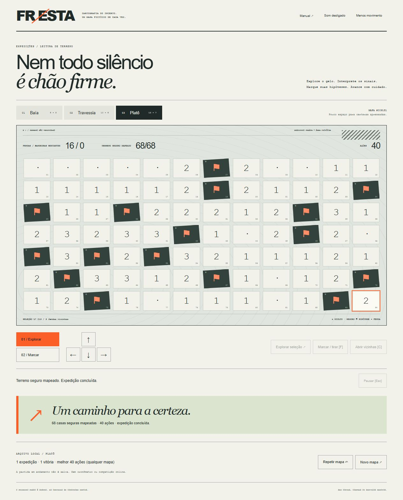

# Fresta

**Leia o gelo antes de avançar.** Um jogo de dedução inspirado na família campo minado, com identidade própria de mapa polar. Explore terreno seguro, interprete os números e marque hipóteses sobre as fendas ocultas.

[Jogar grátis](https://gustapaz.github.io/fresta/)

## Expedições

| Formato | Terreno | Fendas |
| --- | --- | --- |
| Baía | 8 × 5 | 6 |
| Travessia | 10 × 6 | 10 |
| Platô | 12 × 7 | 16 |

A primeira exploração gera um mapa determinístico pela seed exibida e protege a casa escolhida e suas vizinhas. **Primeiro passo seguro não garante solução somente por lógica:** alguns mapas podem exigir risco. O número mostra as fendas nas oito vizinhas, incluindo diagonais. Zero abre a região e a borda. Revelar todo terreno seguro vence; explorar uma fenda encerra a expedição. Não é preciso marcar todas as fendas para vencer.

## Controles

- Toque/clique usa a ferramenta Explorar ou Marcar. Botão direito marca diretamente.
- Com a área focada, setas/WASD movem a seleção; Enter/Espaço explora; F marca; C abre vizinhas; Escape/P pausa.
- Botões direcionais e ações grandes oferecem as mesmas operações, úteis nos formatos densos no celular. As casas do Platô ficam pequenas em telas estreitas.
- Abrir vizinhas exige um número aberto com igual quantidade de bandeiras ao redor. Todas as vizinhas não marcadas serão exploradas; bandeiras erradas podem causar derrota.
- Repetir mantém seed/formato; comece pela mesma primeira casa para reproduzir o terreno. Novo mapa muda a seed. Reiniciar abandona a tentativa sem registrar resultado. Não há cronômetro.

Bandeiras são hipóteses e bloqueiam exploração/propagação; o limite é o número de fendas. A menor quantidade de ações numa vitória fica registrada por formato, em qualquer seed; mapas diferentes podem exigir ações diferentes, portanto não é um ranking comparável ou protegido.

## Stack e execução

Hyperapp 2.0.22 + JavaScript ESM + DOM/CSS + Vite 8.3.5. Modelo puro imutável, ações e efeitos separados da interface declarativa. Sem Canvas, WebGL, engine física ou loop contínuo. Sons procedurais opcionais e movimento reduzido. Sem fotos/fontes/CDN remotos.

Node.js 24 e npm:

```sh
npm ci
npm test
npm run dev
npm run build
npm run preview
```

Desenvolvimento na porta 4269, preview do export na 4270. CI testa, audita, constrói e publica somente dist no GitHub Pages. Base relativa e arquivos de jogo/CSS com hash para atualização de cache.

## Dados, licenças e limites

Sem backend, chaves, contas, compras, cartão, faturamento ou trial. Preferências e resultados ficam no localStorage deste navegador; a tentativa em andamento não é salva. Sem sincronização, garantia offline ou competição online confiável. Dados locais e mapas no cliente podem ser inspecionados/alterados pelo próprio usuário.

Código do jogo MIT. Hyperapp MIT com atribuição preservada em third-party.txt. Mapa fictício, sem orientação real para expedições. Nenhum nível, sprite, marca ou asset de jogo comercial importado.

[Design](docs/game-design.md) · [Assets/licenças](docs/assets.md) · [Testes e limites](docs/validation.md)


